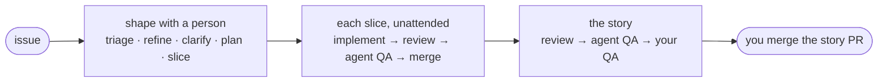

<p align="center">
  
</p>

<h1 align="center">norn</h1>

<p align="center">
  <strong>Spec-driven development for coding agents, with GitHub as the only state.</strong>
</p>

<p align="center">
  <a href="https://github.com/PruszynskiJakub/norn/actions/workflows/ci.yml"></a>
  <a href="https://github.com/PruszynskiJakub/norn/releases"></a>
  
</p>

> [!NOTE]
> norn is pre-1.0: a minor version can break things, and [`CHANGELOG.md`](CHANGELOG.md) says how to upgrade. It is tested on Claude Code; other agents should work but are untested.

norn is a CLI that your coding agent calls to run work through a spec-driven process. A person shapes each story with their agent (triage, refine, clarify, plan, slice); then norn hands the slices to fresh agents that implement, review, QA and merge them, and stops when it needs a person. Every state lives in GitHub labels, sub-issues, comments and branches, so there is no server, no database and nothing to sync.

## Why norn

- **The agent is the operator, norn is the process.** The agent asks norn what to do next and which skill to use, does the work, and reports the outcome. norn decides the next state.
- **GitHub is the source of truth.** Your team sees every story's state in GitHub, and norn keeps no state of its own.
- **Your own `gh`, your own identity.** No separate auth: every label, comment, PR and merge is made as you.
- **Agents can't step on each other.** Each issue is claimed with a git ref that only one session can hold, and only norn changes labels.
- **People stay in the loop where it matters.** Shaping a story is attended, a person always QAs the story, and an issue that keeps failing review or QA is escalated instead of retried forever.

## How it works



You ask your agent `norn-drive <issue>` to shape a story with you. Once it is sliced, `norn-deliver <story>` runs the slices in parallel, each step in a fresh agent in its own git worktree, and merges them into the story branch. It stops when the story is ready for your QA, or when something needs a person, and notifies you. See [how norn works](docs/how-it-works.md) for the full process.

## Requirements

- Node 20 or later and git
- [`gh`](https://cli.github.com), logged in (`gh auth status`) with write access to your repository
- A coding agent: [Claude Code](https://claude.com/claude-code) is tested; others are supported but untested
- A team that assigns each issue to exactly one owner (see the [assumptions](docs/how-it-works.md#assumptions))
- Recommended: [herdr](https://herdr.dev), which gives every agent its own pane and session

## Install

norn is not on npm yet. While this repository is private, you need read access to it. Install a release tag, which carries the built CLI:

```sh
npm install -D github:PruszynskiJakub/norn#v0.7.0
```

Only release tags can be installed: a branch or commit has no built CLI.

## Quick start

```sh
npx norn init      # skills, agent instructions, .agents/, labels
```

Commit what `init` wrote, then ask your agent:

```text
norn-drive <issue>
```

For a guided first run in a throwaway repository, follow the [sandbox tutorial](docs/tutorial.md).

## Commands

| Command | What it does |
| --- | --- |
| `norn init` | Set up the project: skills, agent instructions, `.agents/`, labels |
| `norn next <story>` | What can be done on the story now |
| `norn take <issue>` | Claim the issue and get the briefing for its step |
| `norn done <issue> [outcome] ["note"]` | Finish the step; norn makes the transition |
| `norn status <story>` | Read-only overview of the story and its slices |
| `norn tidy` | Remove what belongs to closed issues |
| `norn dashboard` | Watch your work in the browser |

Your agent runs most of these for you. Add `--json` for scripts. See [commands](docs/commands.md) for every command and flag.

## Dashboard

`npx norn dashboard` serves a read-only page on localhost: what needs you, with the command to pick it up, your stories and their slices, and a feed of what the agents did.


## Documentation

- [How norn works](docs/how-it-works.md): principles, assumptions, labels, flows, claims and delivery
- [Commands](docs/commands.md): every command, flag and output
- [Configuration](docs/configuration.md): team and local settings, providers, notifications
- [Tutorial](docs/tutorial.md): try norn in a sandbox repository
- [Glossary](CONTEXT.md): the domain terms
- [Changelog](CHANGELOG.md)

## Contributing

See [`CONTRIBUTING.md`](CONTRIBUTING.md) for setting up, the checks and how releases are cut. To report a vulnerability, see [`SECURITY.md`](SECURITY.md).

## Acknowledgements

The `norn-codebase-design` and `norn-tdd` skills and the approach of the step skills are adapted from [mattpocock/skills](https://github.com/mattpocock/skills) (MIT).
