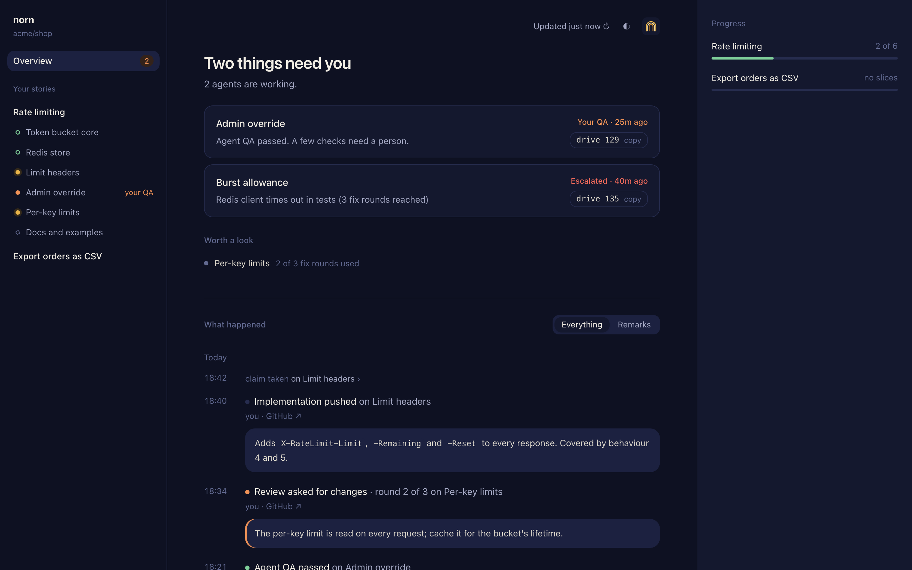

# Commands

norn is run through `npx norn` in a project that has it installed. Run `norn` with no arguments to list the commands. Every command that works on an issue takes its number explicitly, and every command takes `--json` for machine-readable output; prose is the default.

norn answers in prose written as instructions to the agent, always in the same order: where you are, what to do now (including the skill to invoke), how to finish (the exact commands), and what not to do. A refusal says why and what to do instead.

| Command | What it does |
| --- | --- |
| [`norn init`](#norn-init) | Set up the project: skills, agent instructions, `.agents/`, labels |
| [`norn next <story>`](#norn-next) | What can be done on the story now |
| [`norn take <issue>`](#norn-take) | Claim the issue and get the briefing for its step |
| [`norn done <issue> [outcome] ["note"]`](#norn-done) | Finish the step; norn makes the transition |
| [`norn status <story>`](#norn-status) | Read-only overview of the story and its slices |
| [`norn deliver <story>`](#norn-deliver) | Run every step an agent can do, each agent in a herdr pane, until only people can move the story on |
| [`norn run <issue>`](#norn-run) | Start a supervised run of the issue's step, its agent in a herdr pane |
| [`norn tidy`](#norn-tidy) | Remove what belongs to closed issues |
| [`norn dashboard`](#norn-dashboard) | Watch your work in the browser |
| [`norn doctor`](#norn-doctor) | Check the whole setup and say what to fix |
| [`norn flows export <name>`](#norn-flows-export) | Copy a built-in flow into the repository to change it |
| [`norn add-slice <story> "title"`](#norn-add-slice) | Create a slice (used by the `norn-slice` skill) |
| [`norn escalate <issue> "reason"`](#norn-escalate) | Set `needs-human` and release the claim |
| [`norn release <issue>`](#norn-release) | Give up the claim without a transition |

`norn --version` prints the running norn's version. `norn --help`, or `--help` (`-h`) after any command, prints the list of commands and runs nothing.

norn calls an issue by its type, the flow it runs: a story is `Story #123`, an issue of a repository flow `bug` is `Bug #40`, its PR the bug PR.

## norn init

```sh
npx norn init
```

Sets norn up in the current repository. Running it again is safe and refreshes what it wrote.

- **Skills.** Copies the bundled skills into `.agents/skills/` and links them into `.claude/skills/`: one per step (`norn-triage`, `norn-refine`, `norn-clarify`, `norn-plan`, `norn-slice`, `norn-implement`, `norn-review`, `norn-auto-qa`, `norn-qa`, `norn-merge`, `norn-resolve`), the process skills (`norn-drive`, `norn-deliver`) and the reference skills they use (`norn-interview`, `norn-codebase-design`, `norn-tdd`). After upgrading norn, run `init` again: it replaces any bundled skill that differs from the new version and names them; `git diff .agents/skills/` shows the changes. A `skills/` directory is left alone: it is the project's own. Set `NORN_SKILLS_SOURCE=<repo>` to install the skills with `npx skills add <repo>` instead; skills from that source already in place are kept.
- **Agent instructions.** Writes a short norn section between `<!-- norn:start -->` and `<!-- norn:end -->` into `AGENTS.md` and `CLAUDE.md`, whichever exist. With neither, it creates `AGENTS.md` and a `CLAUDE.md` that imports it.
- **Files.** Creates `.agents/specs/` and the team config `.agents/norn.config.json`, taking `baseBranch` from the repository's default branch. Adds `.agents/worktrees/` and `.agents/norn.config.local.json` to `.gitignore`.
- **Version.** Records the running norn's version as [`nornVersion`](configuration.md#the-norn-version) in the team config. On a repository set up before, it changes `nornVersion` and no other setting, and reports the change next to the skills it updated, so the two are committed together. It refuses when the repository's `nornVersion` is newer than your norn: upgrade norn instead of rolling the team's skills back.
- **Labels.** Creates norn's labels on the GitHub repository: every state of the valid [flows](flows.md) on the base branch, built-in or the repository's, `type:<flow>` for each flow, and the flags `in-progress`, `needs-human`, `mode:afk` and `mode:hil`. A state's label takes its `color` and `description`, or a default for its kind. An invalid flow is skipped; `norn doctor` reports it. Labels are never deleted.

It ends by suggesting `norn doctor`, which checks what `init` cannot set up.

## norn next

```sh
npx norn next <story>
```

Lists what can be done on the story now, each item with the command that starts it, and what is waiting and why. It is the entry point for `norn-deliver`. On an issue of a [repository flow](flows.md) it lists the issue itself: for a person at a human gate, else to start, attended as its state says.

```text
Story #123 "Rate limiting" is in implementation. 2 of 7 slices are merged
into 123-rate-limiting.

You can start 3 items now. They are independent, so run them in parallel, at
most 2 at a time, each in its own fresh subagent, told to work in the item's
worktree:

  - Slice #131 "Per-key limits" is in ready-for-agent: Ready for an agent.
    Worktree: /repo/.agents/worktrees/123-rate-limiting-131
    Start it with: norn take 131
  - Slice #128 "Limit headers" is in needs-review: Waiting for review.
    Worktree: /repo/.agents/worktrees/123-rate-limiting-128
    Start it with: norn take 128
  - Slice #127 "Redis store" is in merge-queue: Queued to merge.
    Worktree: /repo/.agents/worktrees/123-rate-limiting-127
    Start it with: norn take 127

Waiting, nothing to do for you:
  - #132 is blocked by #131.
  - #129 needs human QA (mode:hil). Do not take it.

Each phase gets a new agent. When an item is done, run norn next 123 again.
```

- It offers only the free slots under `deliver.maxParallel`, counting your agents already running on the story.
- An item for a person that a session already holds is listed as held by it, with no hand-off.
- It catches up on follow-ups a `norn done` could not finish (story branch, unblocking slices, story PR, `needs-review`), closes a story whose PR is merged if GitHub did not, and removes state labels left on closed issues.
- Under the git provider it gives each agent it lists its own `NORN_SESSION`.
- Under herdr it names `norn run <issue>` for each item an agent can do, and `norn deliver <story>`, which runs them all.

## norn deliver

```sh
npx norn deliver <story>
```

Delivers the story: asks `norn next`, starts a [run](#norn-run) for each item an agent can do, up to `deliver.maxParallel`, and when a run finishes asks again, so each step gets a new agent, until nothing runs and nothing can start. It ends with `norn next`'s report: what waits for a person and why. It runs for as long as the story has work for agents, possibly hours, and prints a line for every run it starts and every run that ends.

```text
09:12:03  Delivering #123: each step an agent can do runs in its own herdr pane. This runs until only people can move the story on.
09:12:05  #131 implement: started a run with claude (session run-131-a1b2).
09:12:06  #132 implement: started a run with claude (session run-132-c3d4).
09:40:51  #131 (1 attempt, 28.8m): its agent finished the step.
09:40:53  #131 review: started a run with claude (session run-131-e5f6).
```

- It needs herdr: start it from a herdr pane, not from inside an agent whose permissions keep it from starting agents.
- One `norn deliver` per story on a machine: a second refuses, naming the first.
- Stopped and started again, it carries on from GitHub. Runs still going are left to finish, and a run whose supervisor died has its agent stopped; its item is offered again once the run's lease runs out, and `norn deliver` waits for that.
- Attended steps, human QA and `needs-human` are left to people. Once a person moves an issue on, `norn deliver` sees it within two minutes.

## norn run

```sh
npx norn run <issue> [--agent <name>]
```

Starts a supervised run of the issue's current step and returns at once. It checks that `norn next` offers the issue to an agent, makes its worktree, and starts a supervisor process that outlives it. The supervisor starts the agent (`--agent`, else `run.agent`) in a `norn-<issue>` tab of the worktree's herdr workspace, tells it to take the issue and finish its step, and watches it as [configuration](configuration.md#runs) describes: it keeps the claim's lease fresh, stops a stalled or timed-out agent, retries an attempt that ended without the step finished, and gets the issue `needs-human` after `run.maxAttempts`. A finished step's pane is closed; an escalated one's is left for the person called in.

It refuses an attended step, an item that waits, and an item that already has a run on this machine. `norn deliver` uses it for every item; run it yourself to hand one item to an agent.

## norn take

```sh
npx norn take <issue> [--takeover]
```

Claims the issue and prints the briefing for its current step: the worktree and branch to work in (with the command to create the worktree if it is missing), the skill to invoke, what to read, where to commit and push, and the `norn done` commands that finish the step.

```text
You now hold story #123 "Rate limiting". Its step is refinement. This step
is attended: the user takes part, and you do not decide on your own.

Work in: /repo/.agents/worktrees/123-rate-limiting (branch 123-rate-limiting)
It does not exist yet. Create it first:
  git -C /repo fetch origin main && git -C /repo worktree add --no-track /repo/.agents/worktrees/123-rate-limiting -b 123-rate-limiting origin/main

Invoke the skill: refine
Spec to work on: .agents/specs/123-rate-limiting/spec.md
Read the issue: gh issue view 123 --comments
Commit the spec on 123-rate-limiting and push it, so the link norn posts resolves.

When the user agrees refinement is finished, run one of:
  norn done 123 clear       (no open questions, moves on to planning)
  norn done 123 questions   (open questions, moves to clarification)

On a long step, run norn take 123 again now and then: it keeps your claim fresh.
If you have to stop, run: norn release 123
If something is wrong and a person is needed, run: norn escalate 123 "reason"

Do not change labels yourself. Only norn changes them.
```

- Running `take` again on an issue you hold re-briefs you and refreshes the claim.
- A stale claim (older than `claims.staleAfter`) is taken over by one session only.
- `--takeover` takes over a claim of your own GitHub user at any age, for a session of yours that stopped. It never takes a teammate's claim.

## norn done

```sh
npx norn done <issue> [outcome] ["note"] [--evidence <dir>]
```

Finishes the step: norn makes the transition, posts a comment and releases the claim. The outcome word is needed only when the step can end more than one way (see [steps, skills and outcomes](how-it-works.md#steps-skills-and-outcomes)). The note carries review requests, QA results or a rejection reason. `--evidence <dir>` pushes the QA files in `<dir>` to `norn/qa/<issue>` and embeds them in the comment.

It refuses, changing nothing, while the step's work is not where the flow needs it: leaving a state with `opensPR` needs the issue's PR open, closing an issue of a flow with `opensPR` needs that PR merged, and leaving a state with `slices` needs a slice. When the outcome sets `needs-human`, from the flow's `needsHuman` or the fix-round limit, `done` says so and why.

Follow-ups after the transition (story branch, unblocking slices, story PR, `needs-review`) are best effort; `norn next` catches up on any that failed.

## norn status

```sh
npx norn status <story>
```

A read-only overview of the issue and its slices: its owner and, when its flow gives it one, its branch, and for each item its state, mode, open blockers, `needs-human` and whether a claim holds it (and whether that claim is stale). An issue whose flow has no slices shows on its own.

## norn tidy

```sh
npx norn tidy [--dry-run]
```

Removes what belongs to closed issues: QA evidence branches, worktrees, merged branches and claim refs. Anything with uncommitted or unpushed work is named and kept. `--dry-run` only lists. `norn-deliver` and `norn-drive` run it for you.

Under herdr it also closes the `norn-<issue>` tabs that runs left in the repository's herdr workspaces, e.g. of a step worked in the main checkout, keeping those of a live run and of an issue that still needs a human, who finds the escalated run's agent there.

## norn dashboard

```sh
npx norn dashboard [--port <n>] [--interval <duration>] [--no-open]
```

Serves a read-only page on `127.0.0.1` over your norn work in this repository and opens it in your browser:

- what needs you (`needs-human` and `needs-human-qa`), each with its `norn-drive` command;
- what is worth a look: stale claims and items one fix round from the limit;
- your stories with their slices and progress;
- a feed of what happened, with the agents' implement, review and QA remarks and links to their evidence;
- a Flows page (`#flows`): every flow of the repository, marked built-in, overridden or the repository's own, and valid or invalid with its errors, each drawn as a graph of its states and the outcomes between them, with each state's behaviours and `when` mode. It only shows the flows; you change one by merging a change to its file.



It reads GitHub as you every 2 minutes (30s at the least), with one GraphQL query plus `git ls-remote` per read, shared by every open tab. It changes nothing and keeps no state, and runs until Ctrl-C.

- Port 4477 moves to the next free one when taken, unless you gave `--port`.
- A second launch for the same checkout prints the running one's URL.
- `--interval` takes a duration such as `30s`, `2m` or `1h`.
- Set defaults in your local config: see [configuration](configuration.md#dashboard).

## norn doctor

```sh
npx norn doctor [--json]
```

Checks the whole setup at once and lists every check, each with the exact command that fixes it:

| Check | Passes when |
| --- | --- |
| `gh` | `gh` is installed and logged in to the host of `origin` |
| `git` | You are in a git checkout whose `origin` is on GitHub |
| `base-branch` | `baseBranch` exists on GitHub |
| `permission` | You have write access or higher to the repository |
| `labels` | The labels of every valid flow and norn's flags exist, as `init` creates them; a label of norn's that no flow uses, on the base branch or in your working copy's flow files, (one norn created, by the `(norn)` at the end of its description, a `type:`, or a state a flow renamed) warns, and is never deleted |
| `flows` | The flows on the base branch, and every flow file in your working copy that differs from it, are valid; every `.json` file in `.agents/flows/` is named as a type can be, e.g. not `Bug.json`; the skills they name are installed. It names the type of the slices each flow makes, and lists, as warnings, the labels your local flow edits need that the repository lacks and the open issues they would orphan: those in a state the edit drops without naming it in `renamed` |
| `config` | The team and local config are valid; their warnings show as a warning |
| `version` | `nornVersion` is set and compatible with your norn; a compatible difference warns |
| `skills` | Every skill the briefings name is in `.agents/skills/` and linked from `.claude/skills/`; a skill that differs from the bundled copy warns, except under `NORN_SKILLS_SOURCE` |
| `agent-instructions` | The norn block is in `AGENTS.md` or `CLAUDE.md` |
| `provider` | The worktree provider matches the environment, as `take` requires |

Each check shows as `✓` ok, `!` warning, `✗` fail, or `-` skipped when a check it needs did not pass, e.g. `skipped, needs gh`. A check with several problems lists each on a line of its own. It exits 1 only when a check fails, so CI can run it without failing on a warning. `--json` gives `{ ok, checks: [{ id, level, message, fix }] }`.

The `flows` check validates your uncommitted `.agents/flows/*.json` before you open the PR, so a broken flow never reaches the base branch. A local file the same as the base branch's is reported once, as the base branch's.

`doctor` changes nothing and never refuses: an invalid config, an incompatible version or a run outside a checkout are reported as checks.

## norn flows export

```sh
npx norn flows export <name>
```

Writes norn's built-in flow `<name>`, `story` or `slice`, to `.agents/flows/<name>.json` as a starting copy for the team's own version. Once that file is merged into the base branch, it replaces the built-in flow of its name completely: norn takes nothing from the built-in one, for triage, `take`, `done`, `next` and `add-slice` alike. Unchanged, the copy runs exactly like the built-in flow. See [Repository flows](flows.md) for the format.

```text
Wrote .agents/flows/story.json, a copy of the built-in story flow.
Change it there and merge it into the base branch; from then on it runs in place of the built-in story flow, with nothing taken from it.
```

It refuses when the file exists, leaving it as it is, and names the built-in flows when `<name>` is not one of them. It works in the current directory and needs neither GitHub nor the team config. `--json` gives `{ ok, flow, file, message }`.

## norn add-slice

```sh
npx norn add-slice <story> "title" --mode afk|hil [--blocked-by <issue>]...
```

Creates a slice as a sub-issue of the story, with its labels, the story's assignee, its native "blocked by" relations and its mode. The slice gets the type the story's flow names and starts in that type's start state, or held while a blocker is open; the answer names that state. A missing label for either is created first, with its colour and description. The `norn-slice` skill calls it; you rarely need it by hand.

## norn escalate

```sh
npx norn escalate <issue> "reason"
```

Sets `needs-human` with the reason as a comment and releases the claim. A person clears it with `norn-drive <issue>`, which runs the `norn-resolve` skill.

## norn release

```sh
npx norn release <issue>
```

Gives up the claim without a transition, for an agent that has to stop.
