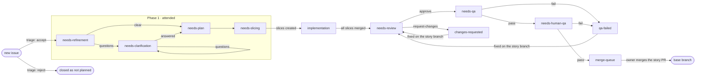
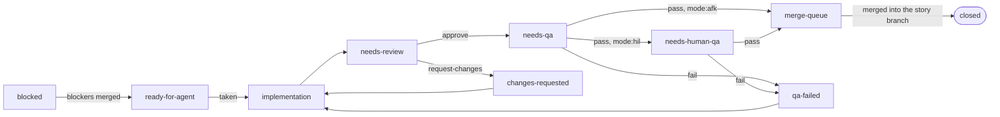

# How norn works

norn is a CLI that a developer's coding agent calls to run work through a spec-driven process, with GitHub as the only source of truth. This page explains the process and the ideas behind it. The terms it uses (story, slice, step, claim, briefing, outcome, needs-human, fix round and the rest) are defined in [`CONTEXT.md`](../CONTEXT.md).

- [Principles](#principles)
- [Assumptions](#assumptions)
- [Labels and flags](#labels-and-flags)
- [Story flow](#story-flow)
- [Slice flow](#slice-flow)
- [Steps, skills and outcomes](#steps-skills-and-outcomes)
- [QA](#qa)
- [Branches, PRs and worktrees](#branches-prs-and-worktrees)
- [Claims and sessions](#claims-and-sessions)
- [Unattended delivery](#unattended-delivery)
- [Limits](#limits)
- [Notifications](#notifications)
- [Artifacts](#artifacts)
- [Housekeeping](#housekeeping)

## Principles

- **The agent is the operator, norn is the process.** The agent asks norn what to do next and which skill to use, does the work, then asks norn to record the result.
- **GitHub is the source of truth.** State lives in issue and PR labels, native "blocked by" relations, sub-issues, comments, branches and git refs. norn keeps no state of its own.
- **Your own `gh` is used.** There is no separate auth and no server. Every label change, comment, PR and merge is made as you.
- **norn owns transitions, skills own content.** Only norn changes labels, and it allows only valid transitions. The skill for each step tells the agent how to do the work, and knows nothing of norn.
- **Work is scoped to one story.** Every command takes the story or issue number explicitly; there is no session state.
- **Outcomes, not states.** The agent never names a label. It reports what happened (`approve`, `fail`), and norn picks the next state.
- **Refusals are instructions.** When norn refuses a call, it says why and what to do instead.

## Assumptions

norn is built for a team that works in a particular way. It checks some of these and relies on the rest.

| Assumption | Checked by norn? |
| --- | --- |
| **Each issue has exactly one owner**: its GitHub assignee, who is responsible for it end to end, including its slices and PRs. Slices created by norn get the story's assignee. | No. norn reads the first assignee as the owner; the dashboard shows the stories assigned to you. |
| **Only the story's owner merges the story PR** into the base branch. | Partly. An agent that takes a story in `merge-queue` is refused and told who the owner is. |
| **A story and its slices live in one repository.** Slices are the story's sub-issues labelled `type:slice` in the same repository; other sub-issues are ignored. | Yes. |
| **Stories merge into one base branch** (`baseBranch`, the repository's default branch unless configured). | Yes. |
| **Labels are changed only through norn.** A label changed by hand can leave an issue with two states, which norn refuses to brief until a person fixes it. | Yes, it detects the mess but does not prevent it. |
| **Everyone works through their own `gh`**, logged in with write access to the repository. | Yes, every command fails without it. |
| **Stories and slices run norn's built-in process**, so every repository that uses norn works the same way for them. | Yes. Other kinds of work run the repository's own [flows](#repository-flows). |

## Labels and flags

Each issue carries exactly one state label from its type's set. Flags sit alongside it.

| State | Story | Slice | Meaning |
| --- | :-: | :-: | --- |
| `needs-refinement` | ✓ | | Triaged; the spec is being refined |
| `needs-clarification` | ✓ | | Refinement found questions or unknowns |
| `needs-plan` | ✓ | | All questions answered; the plan goes into the spec |
| `needs-slicing` | ✓ | | Plan done; slices to be created |
| `blocked` | | ✓ | Has an open native "blocked by" relation |
| `ready-for-agent` | | ✓ | Unblocked, can be picked up |
| `implementation` | ✓ | ✓ | Story: slices exist and are in progress. Slice: being implemented |
| `needs-review` | ✓ | ✓ | Code review of the slice PR or the story PR |
| `changes-requested` | ✓ | ✓ | Review asked for changes |
| `needs-qa` | ✓ | ✓ | QA by an agent, with evidence |
| `needs-human-qa` | ✓ | ✓ | QA by a person, after the agent's |
| `qa-failed` | ✓ | ✓ | QA found problems |
| `merge-queue` | ✓ | ✓ | Implemented, reviewed with no requests, QA passed |

| Flag | Meaning |
| --- | --- |
| `type:story`, `type:slice`, `type:<flow>` | Which process applies: the built-in story or slice, or a [repository flow](#repository-flows) |
| `in-progress` | Someone holds the claim (it mirrors the git-ref claim) |
| `needs-human` | Something went wrong or a person is needed; cleared with the `norn-resolve` skill |
| `mode:afk`, `mode:hil` | Whether a slice also gets QA by a person |

## Story flow

A story is shaped with a person present (phase 1), then follows its slices to the base branch (phase 2).



Triage either accepts an issue into `needs-refinement` or closes it as not planned, with the reason in a comment. Clarification only happens when refinement turns up questions. Once slice issues exist, the story's label follows its slices. When every slice PR is merged into the story branch, the story branch is reviewed and QA'd, by an agent and then by a person. Failed review or QA is fixed straight on the story branch with the `norn-implement` skill and goes back to `needs-review`. Finally the owner merges the story PR, and GitHub closes the story through the PR link.

## Slice flow



`blocked` and `ready-for-agent` follow GitHub's native "blocked by" relations. Both failure states go back to implementation. A slice in `merge-queue` is merged into the story branch by an agent, which resolves conflicts if needed.

## Repository flows

A repository can run other kinds of work through processes of its own. A flow is a JSON file, `.agents/flows/<name>.json`, and an issue labelled `type:<name>` runs it. norn reads flows from the base branch on GitHub, never from the working tree, so a change to a flow takes effect once it is merged, and everyone runs the same process.

```json
{
  "description": "A defect: reproduce it, fix it, close it.",
  "start": "reproducing",
  "workspace": "own",
  "states": {
    "reproducing": {
      "skill": "bug-repro",
      "attended": true,
      "outcomes": {
        "reproduced": { "to": "fixing", "means": "the bug is reproduced, moves on to the fix" },
        "cannot-reproduce": { "to": "not-planned", "means": "no repro; give what you tried", "note": "attempts" }
      }
    },
    "fixing": {
      "skill": "bug-fix",
      "attended": false,
      "color": "d93f0b",
      "description": "an agent fixes the bug",
      "outcomes": { "fixed": { "to": "closed", "means": "the fix is merged" } }
    }
  }
}
```

- `description` says what the flow is for; `start` names the state an issue enters the flow in.
- `workspace` says where the work happens: `none` gives no branch; `own` gives the issue a branch of its own, named from its slug like a story's, and one PR into the base branch. The briefing names the branch, the worktree and the PR command.
- Each state names the `skill` that runs it, whether it is `attended`, and its `outcomes`. Optional fields: `name` (the step's name in the briefing, the state's name by default), `enterAs` (the state the issue moves to when taken), `evidence` (the step may attach evidence), and `color` and `description` for the state's label.
- Each outcome has a target `to`, what it `means`, and optionally a `note` it requires, `needsHuman` and `notify`. `to` is a state of the flow, `closed` or `not-planned`; those two close the issue.
- The first transition into a state whose label is missing creates the label, with the state's colour and description, or a default for an attended or an agent step.
- `needs-human`, claims and `in-progress` work in every flow as they do for stories and slices.

norn checks a flow before it runs it: the start state exists, every target is a state, `closed` or `not-planned`, and no state takes a name norn keeps for itself (`closed`, `not-planned`, `in-progress`, `needs-human`). A broken flow is refused, with what is wrong, only for the issues of its own type.

## Steps, skills and outcomes

Each state has a step, a skill that does its work, and the outcomes the agent reports with `norn done`. Steps with a single way to end take no outcome word.

| State | Skill | Attended | `norn done` outcome → next state |
| --- | --- | :-: | --- |
| new issue | `norn-triage` | ✓ | `accept` → needs-refinement · `reject` → closed as not planned |
| needs-refinement | `norn-refine` | ✓ | `clear` → needs-plan · `questions` → needs-clarification |
| needs-clarification | `norn-clarify` | ✓ | `answered` → needs-plan · `questions` → stays |
| needs-plan | `norn-plan` | ✓ | → needs-slicing |
| needs-slicing | `norn-slice` | ✓ | → implementation (also sets each slice's mode) |
| implementation, changes-requested, qa-failed | `norn-implement` | | → needs-review |
| needs-review | `norn-review` | | `approve` → needs-qa · `request-changes` → changes-requested |
| needs-qa | `norn-auto-qa` | | `pass` → merge-queue (`mode:afk` slice) or needs-human-qa (`mode:hil` slice, story) · `fail` → qa-failed |
| needs-human-qa | `norn-qa` | ✓ | `pass` → merge-queue · `fail` → qa-failed |
| merge-queue (slice) | `norn-merge` | | → closed; dependents recomputed |
| needs-human (flag) | `norn-resolve` | ✓ | → flag cleared, state kept |

Two process skills sit above the step skills: `norn-drive <issue>` takes an issue through the attended steps with you, and `norn-deliver <story>` runs the rest unattended. The step skills lean on three reference skills that norn also installs: `norn-interview` (refine, clarify, plan, resolve), `norn-codebase-design` (plan) and `norn-tdd` (implement).

**The briefing carries the process; skills carry the craft.** Skills know nothing of norn, labels, branches or worktrees: each ends on a result (a spec, a verdict, a breakdown). The `norn take` briefing says what to read, where to work, where to commit and push, which commands create slices and PRs, and which `norn done` each result maps to.

norn also makes some transitions on its own:

- Slice issues created: the story goes to `implementation`.
- A slice merges: dependents with no open blockers go from `blocked` to `ready-for-agent`.
- The last slice merges into the story branch: the story goes to `needs-review`.
- An issue reaches its fix-round limit: it gets `needs-human` instead of going back to implement.

`norn done` makes only the transition and releases the claim; the follow-ups above, plus the story branch and story PR, are best effort. A failure is reported, and `norn next` repeats them.

## QA

An agent always QAs first; a person follows when the item needs one.

| State | Skill | Who | Runs for |
| --- | --- | --- | --- |
| `needs-qa` | `norn-auto-qa` | An agent, unattended | Every slice and every story |
| `needs-human-qa` | `norn-qa` | A person with their agent | Slices in `mode:hil` and every story |

The agent collects the evidence; a person decides. Only a person passes a `mode:hil` slice or a story.

- `norn-auto-qa` runs the app as a user would and records, per criterion, what it ran, what it saw and the evidence. What only a person can check, it lists with whatever it could prepare.
- Evidence is the `norn done` note on the issue, with the files from `--evidence <dir>` pushed to the `norn/qa/<issue>` branch and embedded at their commit.
- `norn-qa` starts from that note: the person's agent runs the app locally and walks them through what is left. A remark outside the criteria becomes a follow-up issue by default.

## Branches, PRs and worktrees

| Level | Branch | Worktree | PR targets | Who merges |
| --- | --- | --- | --- | --- |
| Story | `<id>-<slug>` | `.agents/worktrees/<id>-<slug>` | base branch | The story owner |
| Slice | `<id>-<slug>-<sliceid>` | `.agents/worktrees/<id>-<slug>-<sliceid>` | story branch | An agent |

- There is one PR per slice. A slice merge is accepted only when its PR targets the story branch.
- The slug is recorded once: norn writes `norn: slug <slug>` in its first comment on a story, so renaming the story on GitHub changes none of the names derived from it.
- The story and each slice get their own worktree for the life of their branch. A slice worktree starts from the story branch, the story worktree from the base branch, as they are on GitHub. An existing branch is fast-forwarded; a branch checked out elsewhere gets no create command, and norn names that checkout instead.
- The `take` briefing gives the worktree's absolute path and, when it is missing, the command to create it for the provider in use:

| Provider | Picked in `auto` mode | New agent per step |
| --- | --- | --- |
| herdr | Inside herdr | A new herdr agent in the worktree's pane |
| Claude Code | Inside Claude Code | A new subagent told to work in the worktree |
| git | Otherwise | A new agent session started in the worktree |

When a story PR is merged and GitHub has not closed the story (for example with a `baseBranch` other than the default), `norn next` closes it.

## Claims and sessions

A claim is a git ref, `refs/norn/claims/<issue>`, created on GitHub in one step that either succeeds or fails, so only one session can hold it. Label changes and comments on an issue happen only while holding its claim. The `in-progress` label mirrors the claim so it shows in GitHub; the ref is the real lock.

- **Held for the whole step**, for example all of implement on a slice, and released on handing over to the next state. A person's step is claimed too.
- **Refreshing.** `norn take` on an issue the same session already holds re-briefs it and moves the claim's time forward. Long steps re-run it so a slow session is not mistaken for a crashed one.
- **Stale claims.** A claim older than `claims.staleAfter` (default 2h) is treated as abandoned, and one session can take it over. Its worktree is kept: the next holder is told to check `git status` there before starting.
- **Your own stopped session.** `norn take <issue> --takeover` takes over a claim of the same GitHub user at any age. It never takes a teammate's claim.

**Which session holds a claim.** norn keeps no state, so it tells sessions apart by their environment: `NORN_SESSION`, else `CLAUDE_CODE_SESSION_ID`, else the herdr pane (`HERDR_PANE_ID`), else host and repository root. Under the git provider, `norn next` gives each agent its own `NORN_SESSION`.

> **Known limit.** Claude Code subagents share their parent's session id, so under the `claude-code` provider the `norn-deliver` orchestrator and all its subagents are one norn session. Isolation then relies on `norn next` listing held items as "held by this session". For per-agent isolation, use herdr.

## Unattended delivery

`norn-deliver <story>` runs a story unattended from implementation until it needs a person. You start it once slicing is done (`norn-drive` offers it).

1. Run `norn tidy` once, then ask `norn next <story>` for work.
2. Start a fresh subagent per actionable item, in its worktree, up to the free slots `norn next` gives.
3. Wait for the subagents to finish, then go back to step 1.
4. Once every slice is merged into the story branch, run story review and story QA the same way, plus fixes if either asks for changes.
5. Stop when the story reaches `needs-human-qa` (always a person) or only items waiting for a person remain. Run `norn tidy` and report what is done, what is waiting and who needs to act.

The orchestrator never does a step's work itself, never touches labels, branches or PRs, and never takes an item flagged `needs-human` or in `needs-human-qa`.

## Limits

- **Parallelism:** at most `deliver.maxParallel` (default 2) of your agents at once on a story. `norn next` counts your agents already running and offers only the free slots. A teammate's agents and a person's work do not count.
- **Fix rounds:** after `deliver.maxFixRounds` (default 3) rounds of `changes-requested` or `qa-failed` on one issue, norn sets `needs-human` instead of another round. Rounds are counted from the issue's label history. Once a person resolves it, the issue gets a fresh budget.

When nothing is left to do, `norn next` says so explicitly:

```text
Story #123 "Rate limiting": nothing left that you can do.
Waiting for a human:
  - #129 needs human QA (mode:hil).
  - #131 escalated: "Redis client times out in tests" (3 fix rounds reached).
Stop here and report to the user. norn has already notified them.
```

## Notifications

norn sends local notifications itself, so they fire whatever agent tool is in use:

- when it sets `needs-human`, or an item reaches `needs-human-qa`;
- when `norn next` finds nothing left to do, with a summary of what is waiting. Items a session already holds are left out.

The title says who must act on what (`norn: #131 needs you`); the body gives the reason and the issue link. Where they go is set per developer; see [configuration](configuration.md#notifications).

## Artifacts

- Each story has one spec, built up across refine, clarify and plan: `.agents/specs/<story>-<slug>/spec.md`. Its Behaviour items are numbered user stories that slices, review and QA check against by number.
- Open questions live in a section of the spec. An answered question is removed and the decision is written into the section it affects.
- Slices are GitHub issues only; they have no files.
- On each transition norn posts a short comment linking to the spec at its commit. Review and QA notes and the reason for `needs-human` go in comments too.

## Housekeeping

All cleanup is `norn tidy`. It removes what belongs to closed issues: QA evidence branches, worktrees, merged slice and story branches, and claim refs. Anything with uncommitted or unpushed work is named, not removed. It is idempotent, and `--dry-run` only lists. `norn-deliver` runs it when it starts and stops, `norn-drive` when a story finishes. Nothing is cleaned up at merge: the owner merges the story on GitHub, where norn does not run.
